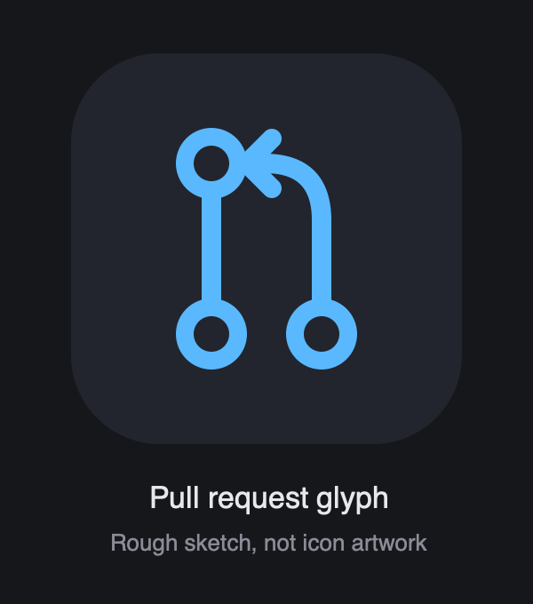

# Icon concept

An idea for the GitHub PRs droplet's Store icon, for Jordy.

The pull request glyph (SF Symbol `arrow.triangle.pull`), the same mark the
widget uses in its header, so the icon and the widget read as one thing. No
Octocat: the droplet is about your review queue, not GitHub itself.

This is a rough sketch, not icon artwork. Kept on its own branch so it never
ships with the droplet.
