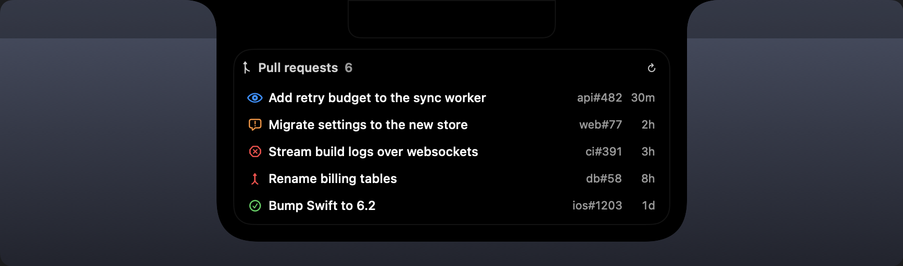

# GitHub PRs

A Droplet for [Droppy](https://getdroppy.app) that lists the open GitHub pull
requests waiting on you, right on your notch.



## What it shows

- Pull requests where your review, or your team's, is requested.
- Your own pull requests that need you: changes requested, failing checks,
  merge conflicts, or approved and ready to merge.
- Optionally, pull requests assigned to you, drafts, and every open pull
  request in the repositories you filter to.

A notch alert appears when a new pull request needs you, and a global shortcut
(suggested ⌃⌥⌘G, rebindable on Droppy's Shortcuts page) opens the shelf on the
widget.


## Setup

Install it from the Droppy Store, then open its settings and add a token:

- **Fine-grained token (recommended):** read-only access to pull requests,
  commit statuses and contents, for the account or organization you want.
- **Classic token:** the `repo` and `read:org` scopes. These also allow writes,
  which this droplet never makes.

The token is stored in your Keychain and only ever sent to `api.github.com`.
You can limit the list to organizations, accounts or `owner/repo` entries.

## Developing

Built with [DroppyKit](https://getdroppy.app/docs/droppykit).

```bash
droppykit run                    # open it in the harness
GITHUBPRS_DEMO=1 droppykit run   # same, filled with sample data
GITHUB_TOKEN=… droppykit run     # same, with your real pull requests
droppykit build                  # produce .build/Githubprs.droplet
droppykit validate               # the checks the Store runs
```

## License

[MIT](LICENSE)
